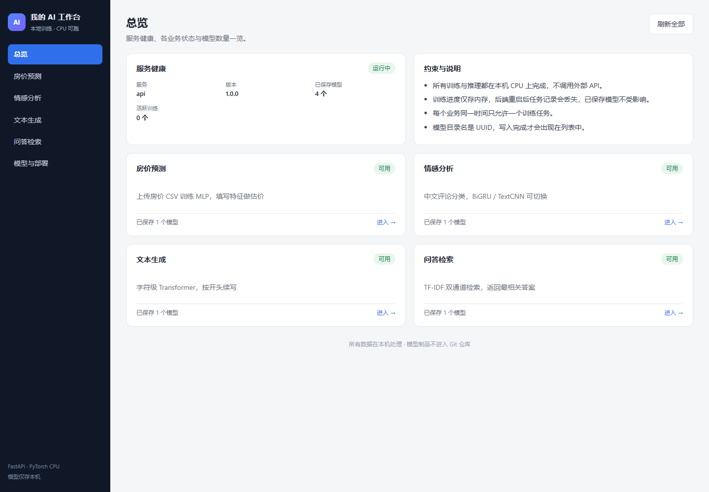
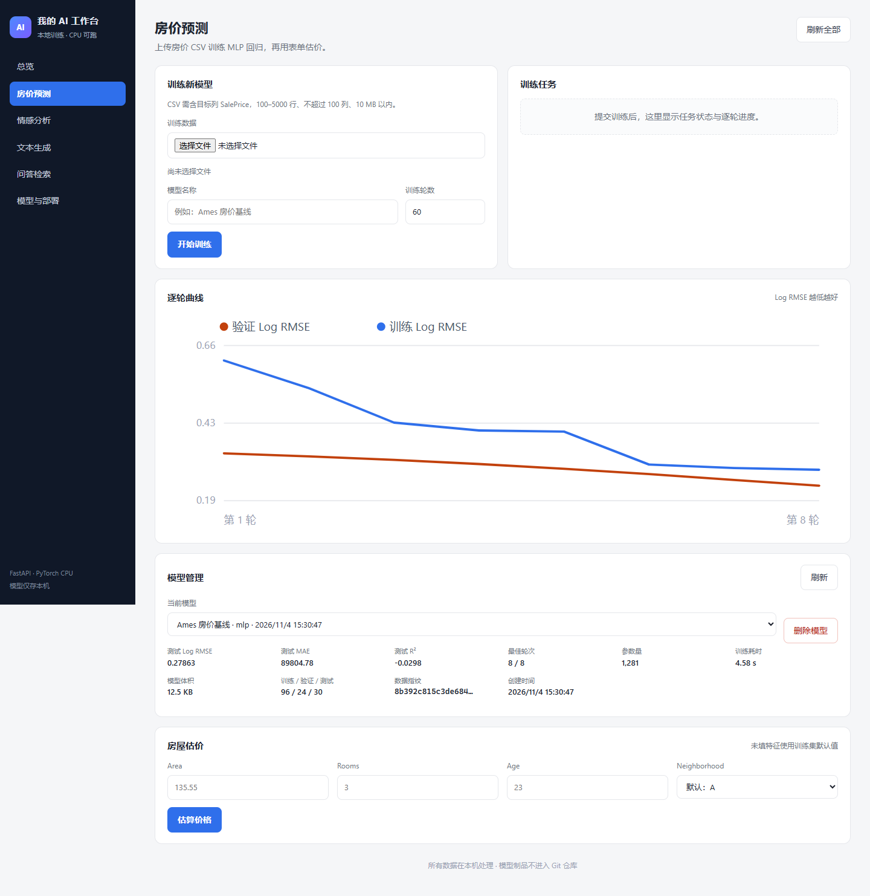

# 我的 AI 工作台

一个可在本机 CPU 上完整跑通的 AI 实验平台：上传数据 → 后台训练小模型 → 管理模型制品 → 在线推理。四个业务模块共用同一套任务、制品与错误约定，前端只有一个 `App.vue`，不依赖 UI 库、路由库和图表库。

> 全流程离线：不调用任何外部 API，模型文件只写在本机 `artifacts/` 目录。





## 技术栈

| 层 | 选型 |
|---|---|
| 后端 | Python 3.11 · FastAPI · uvicorn · PyTorch (CPU) · scikit-learn · pandas · pydantic v2 |
| 前端 | Vue 3 · Vite（`script setup` 单文件 `App.vue`，原生 CSS，内联 SVG 折线图） |
| 部署 | docker compose：`api`（uvicorn）+ `web`（nginx），每个业务一个命名卷 |

## 目录结构

```
.
├── backend/
│   ├── app/
│   │   ├── common.py              # 任务队列 JobRegistry + 制品存储 ModelStore
│   │   ├── house_service.py       # 模块A 房价预测（MLP 回归）
│   │   ├── sentiment_service.py   # 模块B 情感分析（BiGRU / TextCNN）
│   │   ├── generation_service.py  # 模块C 文本生成（字符级 Transformer）
│   │   ├── qa_service.py          # 模块D 问答检索（TF-IDF 双通道）
│   │   └── main.py                # 全部 HTTP 端点与请求模型
│   ├── tests/                     # unittest：每模块健康检查/校验/生命周期/推理
│   ├── Dockerfile
│   └── requirements.txt
├── frontend/
│   ├── src/App.vue                # 六个页面：总览 + 四个业务 + 模型与部署
│   ├── nginx.conf                 # /api → api:8000
│   ├── Dockerfile
│   └── vite.config.ts             # 端口 5175，/api 代理到 127.0.0.1:8000
├── docker-compose.yml
└── README.md
```

## 本地启动

### 后端（端口 8000）

```bash
cd backend
python -m venv .venv
# Windows: .venv\Scripts\activate    macOS/Linux: source .venv/bin/activate
pip install torch==2.15.0 --index-url https://download.pytorch.org/whl/cpu
pip install -r requirements.txt
uvicorn app.main:app --reload --port 8000
```

健康检查：<http://127.0.0.1:8000/api/health>，接口文档：<http://127.0.0.1:8000/docs>。

### 前端（端口 5175）

```bash
cd frontend
npm install
npm run dev
```

访问 <http://127.0.0.1:5175>。开发服务器把 `/api` 代理到 `http://127.0.0.1:8000`（可用 `VITE_API_TARGET` 覆盖）。

### Docker

```bash
docker compose up --build
# 前端 http://127.0.0.1:8080  后端 http://127.0.0.1:8000
```

`web` 等待 `api` 健康检查通过后再启动；四个命名卷分别保存各业务的模型，`docker compose down` 不会删除，`down -v` 才会清空。

### 测试

```bash
cd backend
python -m unittest discover -s tests -v
```

测试会用临时目录（`tempfile.mkdtemp`）重定向四个模型目录，不会污染仓库内 `artifacts/`。

## 通用架构约定

1. **五件套端点**：`POST /api/v1/<业务>/train`（multipart，202 + job_id）、`GET .../jobs/{id}`、`GET .../models`、`DELETE .../models/{id}`、推理端点。
2. **任务模式**：内存 `jobs` 字典 + `RLock` + `ThreadPoolExecutor(max_workers=1)`；同一模块同时只允许一个活跃任务；状态机 `queued → training → saving → completed/failed`，逐轮向 `history` 追加指标并更新 `current_epoch/stage`。
3. **原子落盘**：先写入 `.{uuid}.tmp/`，写完 `metadata.json` 与权重后整体 `rename`；`list_models` 只接受目录名是 UUID、必备文件齐全、`metadata.id` 与目录名一致的目录，按 `created_at` 倒序。
4. **可复现**：`torch.manual_seed(42)`、`DataLoader` 的 `generator`、`train_test_split(random_state=42)`、检索配置顺序全部固定。
5. **三份数据**：train / validation / holdout-test；按验证集指标保存最佳权重，训练结束只评估一次测试集。
6. **统一错误**：业务校验抛 `XxxDataError(ValueError)` → 422（中文 detail 可直接展示）；文件超限 413；扩展名不符 415；模型不存在 404；文件与粘贴文本同时提供 → 422。
7. **推理必带 `notice`**：免责声明字段，前端原样展示。
8. **metadata 必备字段**：`id / name / algorithm / history / best_epoch / test / param_count / train_seconds / model_bytes / data_fingerprint(sha256) / created_at`。

每个模型目录形如：

```
artifacts/<业务>/<uuid>/
├── metadata.json
├── weights.pt            # 或 index.joblib（问答检索）
├── vocab.json            # 分类 / 生成模块
└── preprocessor.joblib   # 房价模块
```

---

## 模块A · 房价预测

**功能**：上传带 `SalePrice` 的房价 CSV，训练 MLP 回归模型；在表单里填写房屋特征做估价，未填字段自动使用训练集中位数（数值）或众数（类别）。

**数据格式**：UTF-8 CSV，必须有目标列 `SalePrice`（全部为正数）；`Id` 列自动排除；数值列与类别列自动识别。

**限制**：≤10 MB；100–5000 行；≤100 列；列名不可重复；独热编码后特征维度 ≤5000。

**处理与模型**：数值列均值填充 + 标准化，类别列常量填充 + 独热；目标取 `log` 后再标准化（std 下限 0.05）；`Linear(d,128) → BatchNorm → ReLU → Dropout(0.2) → Linear(1)`，Xavier 初始化；Adam `lr=1e-3`、MSE、batch 64；60/20/20 划分；默认 60 轮（1–200）。

**指标**：逐轮 train/validation Log RMSE、validation MAE；测试集 Log RMSE / MAE / R²。

| 方法 | 路径 | 说明 |
|---|---|---|
| POST | `/api/v1/house/train` | `file`, `name`, `epochs` → 202 + job |
| GET | `/api/v1/house/jobs/{id}` | 任务状态、`history`、`current_epoch` |
| GET | `/api/v1/house/models` | 模型清单 |
| DELETE | `/api/v1/house/models/{id}` | 删除模型目录 |
| POST | `/api/v1/house/predict` | `{model_id, features}` → `{data:{price,currency}, notice}` |

---

## 模块B · 情感分析

**功能**：中文文本分类，`BiGRU` 与 `TextCNN` 可切换；输出全部类别概率、分词预览与测试集混淆矩阵。

**数据格式**：CSV（`text,label`，也接受 `正文,类别`，可选 `title/标题` 拼接）或 JSONL（每行 `{"text": "...", "label": "..."}`）。

**限制**：≤5 MB；50–5000 条；2–12 个类别、每类 ≥5 条；单条文本 ≤2000 字；类别名 ≤50 字。

**处理与模型**：jieba 分词（英文片段正则兜底），训练集建词表 ≤12000，截断 128 token（PAD=0 / UNK=1）；分层 70/15/15；
- BiGRU：Embedding(64) + Dropout(0.3) + 双向 GRU(64) + 拼接首尾隐状态 + Linear；
- TextCNN：Embedding(64) + Conv1d(k=3/4/5, 64) + 带长度掩码的 max-over-time pooling + Linear。

Adam `lr=3e-3`、batch 32、CrossEntropy；默认 8 轮（1–20）。

**指标**：逐轮 train/validation loss、accuracy、validation Macro-F1；测试集 accuracy / macro-F1 / 混淆矩阵。

| 方法 | 路径 | 说明 |
|---|---|---|
| POST | `/api/v1/sentiment/train` | `file` 或 `text`（二选一）, `name`, `algorithm`(bigru/textcnn), `tokenizer`(jieba/regex), `epochs` |
| GET | `/api/v1/sentiment/jobs/{id}` | 任务状态 |
| GET | `/api/v1/sentiment/models` | 模型清单 |
| DELETE | `/api/v1/sentiment/models/{id}` | 删除模型 |
| POST | `/api/v1/sentiment/classify` | `{model_id, text}` → 类别概率 + `tokens` + `notice` |

---

## 模块C · 文本生成

**功能**：用字符级语料训练 Decoder-only Transformer，按给定开头续写；支持 top-k 与 temperature 采样。

**数据格式**：TXT（每行一段；不足 10 行时按 `。！？!?` 切句）或 CSV（`content/正文` 列，可选 `title/标题`），也可直接粘贴。

**限制**：≤2 MB；10–2000 行（去重后）；总长 ≤12 万字符；字符词表 ≤3000；开头 1–200 字。

**处理与模型**：字符级词表（PAD/UNK/BOS/EOS），上下文 96 字符、步长 95 滑窗；`width=96、2 层、4 头、FFN 4×、GELU、LayerNorm + 残差`；AdamW `lr=1e-3`、梯度裁剪 1.0、batch 32、CrossEntropy(ignore PAD)；8/1/1 划分；默认 5 轮（1–20）。

**指标**：逐轮 train/validation loss 与 validation perplexity；测试集 loss / perplexity / 下一字符准确率。

**推理参数**：生成长度 10–120，温度 0.2–1.5，top-k 1–50。

| 方法 | 路径 | 说明 |
|---|---|---|
| POST | `/api/v1/generation/train` | `file` 或 `text`, `name`, `epochs` |
| GET | `/api/v1/generation/jobs/{id}` | 任务状态 |
| GET | `/api/v1/generation/models` | 模型清单 |
| DELETE | `/api/v1/generation/models/{id}` | 删除模型 |
| POST | `/api/v1/generation/generate` | `{model_id, prompt, max_new_tokens, temperature, top_k}` |

---

## 模块D · 问答检索

**功能**：用问答对建立 TF-IDF 双通道索引（词 n-gram + 字符 n-gram 加权融合），按相似度返回 top-k 答案。没有神经网络权重，"训练"是逐轮搜索检索配置。

**数据格式**：CSV（`question,answer`，也接受 `问题,答案`）或 JSONL（`{"question": "...", "answer": "..."}`）。

**限制**：≤5 MB；10–2000 组；问题 ≤300 字；答案 ≤2000 字；配置搜索 1–8 轮。

**处理与模型**：jieba 分词 + 小写；词级 `TfidfVectorizer(ngram 1–2, sublinear_tf)` 与字符级 `char_wb(2–4)`，L2 归一化后按权重融合；每轮评估一组配置（ngram 与权重），按验证集 MRR 选最优；70/15/15 划分。

**指标**：逐轮 validation Recall@1 / Recall@3 / MRR；测试集 Recall@1、Recall@3、MRR 与 query×answer 的 2×2 命中矩阵（以 top-3 为"预测相关"）。

| 方法 | 路径 | 说明 |
|---|---|---|
| POST | `/api/v1/qa/train` | `file` 或 `text`, `name`, `epochs`（配置搜索轮数） |
| GET | `/api/v1/qa/jobs/{id}` | 任务状态 |
| GET | `/api/v1/qa/models` | 模型清单 |
| DELETE | `/api/v1/qa/models/{id}` | 删除模型 |
| POST | `/api/v1/qa/query` | `{model_id, question, top_k}` → 排序答案 + `notice` |

---

## 前端说明

- hash 路由：`#/overview`、`#/house`、`#/sentiment`、`#/generation`、`#/qa`、`#/deploy`。
- 训练提交后每 1 秒轮询 `jobs/{id}`，`completed` 后刷新模型列表并自动选中新模型。
- 模型管理：下拉选择 + 元数据面板 + 确认删除（`window.confirm`）。
- 顶部统一展示后端 `detail`；请求封装两级超时：普通 12 s，训练/推理 120 s。
- 每个页面都有空态、错误态、加载态；大小/条数/参数范围前后端双重校验。
- 逐轮曲线用内联 `<svg><polyline>` 绘制，不引入图表库。

## 环境变量

| 变量 | 默认值 | 说明 |
|---|---|---|
| `HOUSE_MODEL_DIR` | `artifacts/house` | 房价模型目录 |
| `SENTIMENT_MODEL_DIR` | `artifacts/sentiment` | 情感模型目录 |
| `GENERATION_MODEL_DIR` | `artifacts/generation` | 生成模型目录 |
| `QA_MODEL_DIR` | `artifacts/qa` | 问答索引目录 |
| `VITE_API_TARGET` | `http://127.0.0.1:8000` | 前端开发代理目标 |

## 已知限制

- **训练进度只存内存**：后端重启后 `jobs` 清空，前端轮询会收到 404（模型文件不受影响）。
- **单并发**：每个模块同时只允许一个训练任务，重复提交返回 422。
- **CPU 训练**：示例数据规模下秒级到分钟级；大 CSV（5000 行、60 轮）需要数分钟。
- **检索为字面相似度**：不含语义向量，无法处理完全同义改写。
- **生成质量受语料限制**：字符级小模型，续写可能出现不连贯或事实错误。
- **不提供用户体系与鉴权**：默认只监听本机（`127.0.0.1`），不要直接暴露到公网。

## 交付与版本控制

`.gitignore` 已排除 `artifacts/`、`.venv/`、`node_modules/`、`*.log`、`*.pt/*.pth/*.joblib` 等大文件，Gitee 仓库只包含源码与配置。
